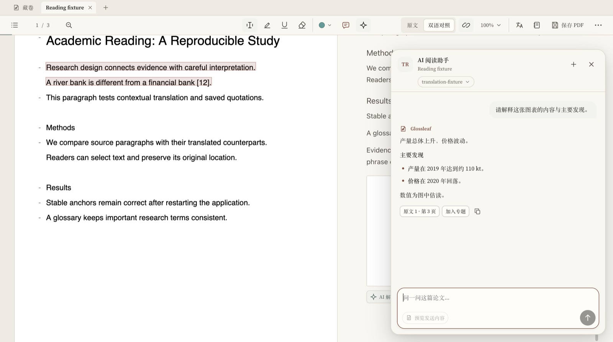
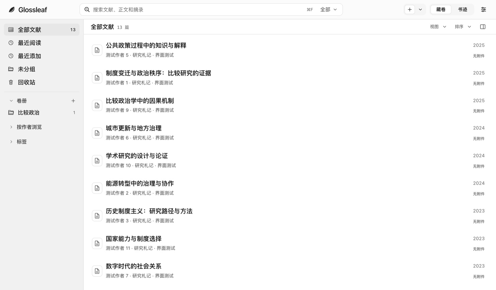
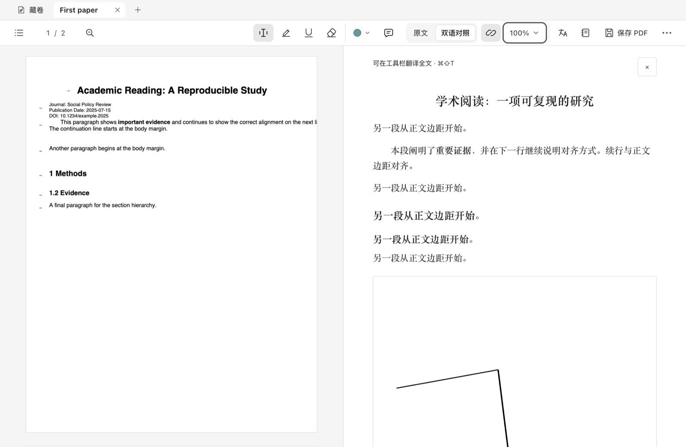
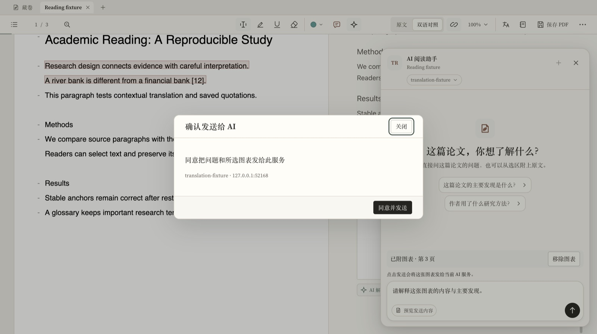
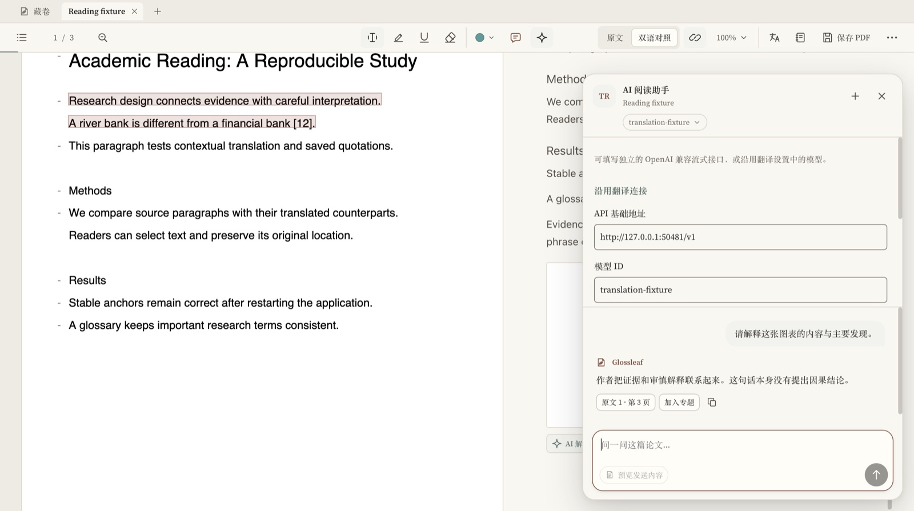
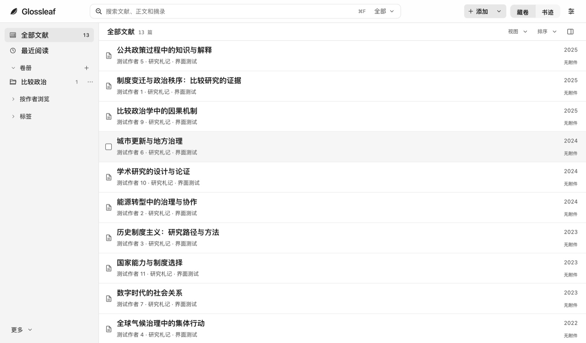

# Glossleaf · 笺

> A quiet home for reading and research.
> 一个给中文母语研究者的本地文献工作台：把外文文献读得下去，把读过的内容找得回来。

macOS（Apple 芯片）与 Windows x64 桌面应用 · Electron + React + TypeScript + PDF.js · 本地优先，不上传任何阅读数据。

[下载 1.1.7](#下载) · [界面](#界面) · [更新日志](docs/CHANGELOG-1.1.x.md) · [文档](#文档)

---

## 下载

当前版本 **1.1.7**（双平台预览包，2026-11-08 构建）。两个包都超过 100 MB，因此以 Release 附件形式提供，不放进 Git 仓库。

| 平台 | 文件 | 体积 | 说明 |
|---|---|---|---|
| macOS（Apple 芯片） | [Glossleaf-1.1.7-Preview-macOS-arm64.zip](https://github.com/krisliu0725/Glossleaf/releases/download/v1.1.7/Glossleaf-1.1.7-Preview-macOS-arm64.zip) | 122 MB | 解压后把应用拖入「应用程序」。ad-hoc 签名，首次打开需右键 →「打开」 |
| Windows 11 x64 | [Glossleaf-1.1.7-Windows-x64.zip](https://github.com/krisliu0725/Glossleaf/releases/download/v1.1.7/Glossleaf-1.1.7-Windows-x64.zip) | 171 MB | 免安装便携版，解压即用。干净环境首次启动为空文库 |

更早的版本见 [Releases](https://github.com/krisliu0725/Glossleaf/releases)。

---

## 它解决什么

中文研究者读外文期刊时的三个具体困境：**读得慢、读完忘、引不准**。

Glossleaf 的做法是：PDF 原文始终是主角，译文按段落对读；所有批注（高亮、朱批）锚定在 PDF 页面坐标上，缩放、旋转、换设备都不丢，并可写回 PDF；札记把一篇文献的阅读成果收成一份可检索、可导出的清单；AI 阅读助手在同一个阅读界面里回答整篇文献或某张图表的问题。

---

## 界面



*展笺 · 原文与译文按段落对照，AI 回答用轻量 Markdown 排版，复杂问题分段分点*



*藏卷 · 全部文献、最近阅读、卷册与题签，窄窗口下自动收拢*

| 译文排版 | 图表问答 |
|---|---|
|  |  |
| 标题、正文与图题建立字号层级，跟随原文居中、缩进与加粗 | 选中图表裁图提问，发送前确认目标服务与页面位置 |

| AI 连接 | 极简主题 |
|---|---|
|  |  |
| 可沿用翻译连接，也可单独填写 OpenAI 兼容的流式接口 | 经典纸色衬线之外，提供黑白灰的极简配色 |

---

## 主要功能

| 模块 | 说明 |
|---|---|
| **书府 Library** | 文献列表、卷册（集合）、题签（标签）、最近阅读、详情面板、导入 PDF 与 Zotero 迁移 |
| **展笺 Reader** | 原文 / 对读双模式，段落级译文联动，页码胶囊（物理页 / 刊印页 / 相对跳转），批注可写回 PDF |
| **批注** | 高亮（7 套色谱 × 6 色）+ 朱批（句批 / 旁批）+ 札记统一视图，全部可撤销 |
| **考索 Search** | 全文检索，命中词高亮，点结果直达原文位置；扫描页同样可检索 |
| **笺注 Translation** | 免费 Google 在线翻译；DeepSeek / OpenAI / Claude / Kimi / Gemini / Ollama，可自改端点与模型，带缓存与术语表；离线模型可应用内安装、暂停续传、校验与移除 |
| **OCR** | 内置英文、简体中文与繁体中文识别，Windows 与 macOS 均在本机运行 |
| **AI 阅读助手** | 整篇提问、选区回查、图表裁图提问（macOS `⌘⇧G` / Windows `Ctrl+Shift+G`），发送前确认，回答支持轻量 Markdown |
| **征引 Cite** | CSL 引文（APA / MLA 等）、RIS / BibTeX / CSL-JSON 导出 |
| **书迹 Profile** | 有效阅读时长、阅读热力图、阅读记录、研究方向（由文献标签聚合）；模型用量按 AI 阅读、AI 翻译、机器翻译分开统计 |
| **留存 Backup** | 一致性快照 + 内容哈希校验，可恢复到空目录 |

---

## 1.1.x 更新要点

| 版本 | 内容 |
|---|---|
| **1.1.7** | AI 回答排版：先给结论，复杂问题再分段分点；图表问答先概括发现、再解释子图；聊天窗口支持轻量 Markdown |
| **1.1.6** | AI 助手发送流程改用 OpenAI JavaScript SDK；修复首次发送与附图提问的授权入口，未配置 / 密钥锁定 / 保存中分别提示 |
| **1.1.5** | AI 连接诊断：文字与图片两种连接测试，显示首段响应时间与总耗时，并把等待拆成准备、连接、排队、推理、接收五段 |
| **1.1.4** | 阅读工作区与设置重整：文献入口区、译文跟随字重与斜体、四档译文字体、图表裁图提问、设置整合 AI 连接与色彩预设、书迹增加阅读记录与文库概况 |
| **1.1.3** | 译文排版与中文题录：书库阅读标签与选中态、译文标题层级、无可靠文字层的页面保留原页、从中文期刊 PDF 补全题录字段 |
| **1.1.2** | 经典与极简双主题：纸色衬线保留，白蓝改为黑白灰极简；缩减书库、导入、顶部切换与阅读工具栏的占用 |
| **1.1.1** | 书库左栏：字号、图标、行高与选中态重整；增加「最近阅读」并从上次位置继续；补充窄窗口布局 |
| **1.1.0** | 双平台公测包：Apple 芯片 macOS 与 Windows 11 x64，空文库起步，内置离线全文翻译可同时处理两段并保留缓存 |

完整记录（时间、验收范围与已知限制）见 [`docs/CHANGELOG-1.1.x.md`](docs/CHANGELOG-1.1.x.md)。

---

## 快速开始

需要 Node ≥ 22 与 pnpm ≥ 10。

```bash
pnpm install --frozen-lockfile
pnpm typecheck
pnpm test          # 154 项单元与集成测试
pnpm build
pnpm start
```

> **如果启动时报 `sandbox initialization failed` 并崩溃**，说明宿主环境限制了 Chromium 沙箱，用
> `./scripts/run.sh start --no-sandbox` 启动。正常桌面环境不需要这个参数。

Windows 包由 `scripts/windows` 下的独立打包工具链交叉构建，需要固定版本的 Electron 发行包，详见项目内的打包脚本。离线翻译与 OCR 的运行组件按需下载，不随源码仓库分发。

---

## 已知限制

- Windows 包在 macOS 上交叉构建，**尚未签名**；Windows 真机启动、PDF 写回与离线推理仍待验收。使用离线模型需安装 Microsoft Visual C++ x64 运行库。
- macOS 包为 ad-hoc 签名，未做 Developer ID 公证，首次启动需要手动放行。
- OCR 与离线翻译模型都在本机运行，首次使用需要下载模型；CPU 推理速度取决于机器。
- 未做并排双 PDF、多窗口与跨设备同步。

---

## 文档

| 文件 | 内容 |
|---|---|
| [`docs/CHANGELOG-1.1.x.md`](docs/CHANGELOG-1.1.x.md) | 1.1.0 至 1.1.7 的逐版本更新记录 |
| [`docs/GLOSSLEAF_UI_REDESIGN_v2.1.md`](docs/GLOSSLEAF_UI_REDESIGN_v2.1.md) | 命名体系、阅读页与书府页重构方案（**设计意图的权威原文**） |
| [`docs/GLOSSLEAF_ANNOTATIONS_v1.2.md`](docs/GLOSSLEAF_ANNOTATIONS_v1.2.md) | 高亮 / 朱批 / 札记的完整规格与数据模型 |
| [`docs/READING-PAGE-PLAN-20261031.md`](docs/READING-PAGE-PLAN-20261031.md) | 阅读页工具栏、页码、朱批的改版方案 |
| [`docs/READER-FUSION-DESIGN.md`](docs/READER-FUSION-DESIGN.md) | 原文与译文的融合布局 |
| [`docs/API-配置说明.md`](docs/API-配置说明.md) | 翻译与 AI 模型连接的配置说明 |
| [`DESIGN.md`](DESIGN.md) | 早期技术设计（领域模型、进程架构、里程碑） |
| [`HANDOFF.md`](HANDOFF.md) | 开发交接说明（历史基线） |
| [`THIRD_PARTY.md`](THIRD_PARTY.md) | 第三方依赖与许可 |

---

## 架构

```
渲染进程（sandbox / contextIsolation）
  └─ 只通过 window.jian.* 具名方法通信
        │
   preload（Result<T> 包装，错误不抛到渲染层）
        │
主进程（窗口、jian:// 文档协议、翻译调度、密钥安全存储）
        │
独立数据服务进程（utilityProcess）
  └─ 全应用唯一 SQLite 写连接
```

三处不可破坏的约束：**数据服务单写连接**、**`origin_map` 四元外部标识**、**`document_version` 的「受管理文件或有效授权」二选一**。

---

## 状态

当前版本 1.1.7。类型检查、生产构建与 154 项自动测试通过；两个平台包均完成文件校验与包内资源检查。

macOS 包在 Apple 芯片机器上验证了 PDF 导入、扫描页检索、批注写回、备份、跨栏对读、在线与离线翻译；Windows 包的启动、PDF 写回与离线推理等待真机验收。

---

## 许可

UNLICENSED · 私有项目，未授权分发。第三方组件许可见 [`THIRD_PARTY.md`](THIRD_PARTY.md) 与 `resources/licenses/`。
