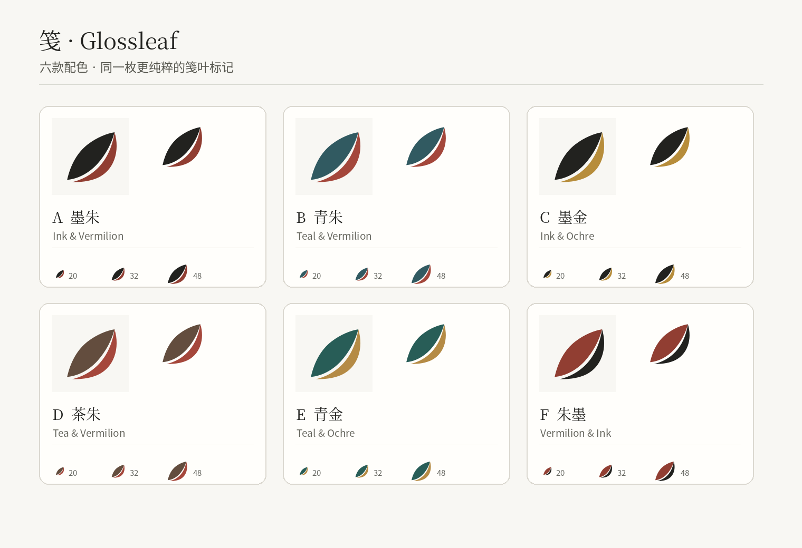
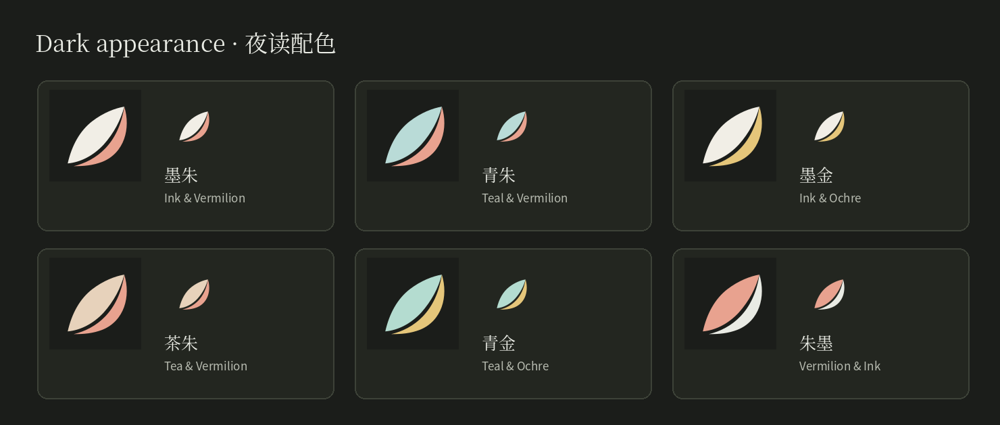
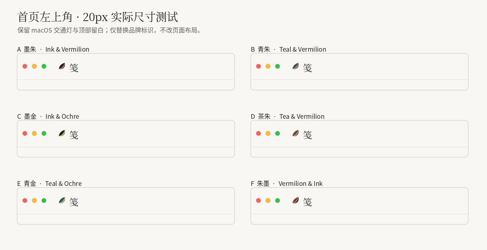

# 笺 · Glossleaf｜Logo V3 品牌介绍与使用规范

> **文件性质：** 品牌说明、视觉资产规范及开发接入要求  
> **适用对象：** 产品设计、前端开发、macOS 打包与测试  
> **选定方案：** `Glossleaf_Logo_Colorways_v3`（六配色版本）  
> **状态：** 品牌图形与配色方案已选定；实际项目接入和 macOS 原生显示效果仍待验证  
> **原则：** 保留此版图形结构，不再采用顶部附加两片小叶的旧方案。

---

## 1. 品牌定位与设计理念

### 1.1 产品名称

- **中文名：笺**
- **英文名：Glossleaf**
- **中英文联合署名：笺 · Glossleaf**

《笺》是一款以外文文献理解与双语阅读为中心的个人文献工作台。它连接文献收集、原文阅读、译文对照、摘录批注与再次检索，强调让研究者既能读懂文章，也能找回读过的内容。

“笺”与传统纸笺、书写、笺注有关；**Gloss** 指注释或译注，**Leaf** 既表示叶片，也可以表示书页。两个名字分别来自不同语言，但共同指向**纸页上的阅读与注解**。

### 1.2 Logo 的核心概念：一叶成笺

**设计主张：让原文与批注，在同一片书叶中相遇。**

最终采用的 V3 Logo 由两块相互呼应的色面组成，中间保留真实透明的曲线缝隙：

| 图形构成 | 含义 | 产品对应 |
|---|---|---|
| 较宽的主色叶形 | 原文、纸页、知识载体 | 文献、PDF 原文、阅读 |
| 较窄的第二色叶缘 | 读者留下的注解与思考 | 译注、摘录、札记 |
| 两者之间的透明留白 | 叶脉、书页折线和页边间隙 | 原文与译文的对应关系 |
| 向右上收束的整体轮廓 | 书写笔势和阅读的延展感 | 阅读—理解—留下痕迹 |

这里的中国文化气质来自**纸笺、朱批与留白**，而不是依赖额外的印章、竹枝、山水或仿古纹理。标志在表达上保持现代、简洁，文化解释则通过品牌文案加以呈现。

### 1.3 为什么选择 V3

V3 是相对于此前方案的**最终选定造型**：

1. 删除主体上方两片独立的装饰叶，不再强行模拟竹字头。
2. 保留一笔式主体、较窄叶缘及正负空间关系。
3. 采用实心色块，不使用描边、渐变、投影和材质纹理。
4. Logo 图形与中英文品牌文字分开排布，适应顶栏小尺寸与 App 图标两种场景。
5. 以同一图形延展六套配色，供用户自选，但不破坏品牌识别的一致性。



> **注意：** 本方案所说的“古典”是文化语义与构形理念，不代表对某一历史书籍纹样的复原。设计介绍不要宣称 Logo 是某一朝代的真实古籍图案。

---

## 2. Logo 标准形态与不可更改的要素

### 2.1 标准构形

标志以 **48 × 48 SVG 视图盒** 为标准，包含两条填充路径；两部分之间的间隙必须是真正的透明区域，而不是用米白色覆盖出来的假留白。

**必须保持不变：**

- 两部分的外轮廓、相对比例与原有朝向；
- 主色形在左、点睛色形在右的层级关系；
- 两色之间的透明留白；
- 不增加顶部小叶、印章、文字、卷轴、装饰线等新元素；
- 不改变路径几何来迁就某一种配色。

**禁止：** 拉伸变形、镜像、旋转、增加描边、填充纹理、渐变、发光、浮雕、厚重投影或在图形内部嵌入“笺 / Glossleaf”文字。

### 2.2 品牌名称的使用

| 场景 | 推荐形式 | 说明 |
|---|---|---|
| 中文界面标题栏 | **Logo + 笺** | 使用实际中文名称，不用拼音替代 |
| 英文界面标题栏 | **Logo + Glossleaf** | 使用直观、完整的英文品牌名 |
| 关于页、品牌说明、对外文档 | **笺 · Glossleaf** | 可并列呈现中英文名称 |
| App 图标 / Dock | **单独 Logo 图形** | 不要把完整品牌文字压进小图标 |
| favicon / 极小标志 | 优先单独图形 | 必要时使用经过验证的单色版本 |

Logo 不承担翻译按钮、书签图标等功能职责。它是**应用品牌标识**，而不是替换所有阅读器功能图标的通用图形。

---

## 3. 六套正式配色

六套方案的形状**完全相同**，仅改变主体色与点睛色。用户在软件中选择的是一种品牌标志外观，而不是整套阅读器主题。

### 3.1 浅色模式

| 代码（ID） | 中文名称 | 英文名称 | 主色 | 点睛色 | 品牌气质 |
|---|---|---|---|---|---|
| `ink-vermilion` | **墨朱** | Ink & Vermilion | `#22221F` | `#913E32` | 传统纸墨与朱批；**默认方案** |
| `teal-vermilion` | **青朱** | Teal & Vermilion | `#315A61` | `#A4473B` | 清雅、克制，兼具现代感 |
| `ink-ochre` | **墨金** | Ink & Ochre | `#22221F` | `#B78D3B` | 低调、沉稳，学术出版气质 |
| `tea-vermilion` | **茶朱** | Tea & Vermilion | `#634D3E` | `#A5473B` | 温润的纸本与书房意象 |
| `teal-ochre` | **青金** | Teal & Ochre | `#285D57` | `#B58B45` | 安静、含蓄的当代东方审美 |
| `vermilion-ink` | **朱墨** | Vermilion & Ink | `#913E32` | `#22221F` | 朱色主导，识别度更强 |

**默认值固定为 `ink-vermilion`（墨朱）**。它与《笺》已有的墨色、暖米底和朱批语言最统一，其他五种保留为个性化选择。

### 3.2 深色模式

| ID | 主体色 | 点睛色 |
|---|---|---|
| `ink-vermilion` | `#F1EEE6` | `#E8A28F` |
| `teal-vermilion` | `#B9DBD7` | `#E8A28F` |
| `ink-ochre` | `#F1EEE6` | `#E5C67A` |
| `tea-vermilion` | `#E7D2BB` | `#E8A28F` |
| `teal-ochre` | `#B4DCD0` | `#E5C67A` |
| `vermilion-ink` | `#E8A28F` | `#E9EBE4` |

**切换规则：** 用户只选择一次配色 ID。主题为浅色时读取 `main/accent`，主题为深色时读取 `darkMain/darkAccent`；系统主题变化时自动切换色值，**不需要用户额外挑选“深色版配色”**。



### 3.3 品牌配色与功能语义色必须隔离

本次选择改变的仅为**Logo 的外观**，不应联动修改：

- PDF 高亮颜色和用户自定义荧光笔色组；
- 朱批、评论和札记已存在的标注颜色；
- 翻译栏的状态色、术语标记色；
- 错误、警告、成功等状态反馈；
- 文献列表、阅读器和系统整体主题色。

例如，用户选择“青金”并不代表批注都要显示为金色；用户选择“朱墨”也不代表系统错误提示应变为品牌红。

---

## 4. 使用场景与尺寸规范

### 4.1 软件首页左上角（优先场景）

- 推荐图形显示尺寸：**20 × 20px**。
- 图形与名称之间的建议距离：**8px**。
- 标志组合区域高度：**至少 32px**，保证可点击面积。
- 界面标题按语言显示 `笺` 或 `Glossleaf`，不要把完整英文名绘制到 SVG 内部。
- 字色仍使用应用的主文字色，**不要让字标逐项跟随六套 Logo 色彩变化**。
- 在 macOS 窗口控制按钮旁保留必要间距，不改变交通灯按钮和窗口拖拽区行为。



这张预览是静态视觉模拟，不能代替真实 Electron/macOS 中的 1×、2×、浅色与深色测试。

### 4.2 设置中的配色选择

建议在现有**设置 → 阅读与外观**下提供一项：

- 中文设置名：**品牌标识配色**；英文：**Logo Color**。
- 采用六种固定选项；每项显示小图形预览、名称和选中状态。
- 默认选中“墨朱 / Ink & Vermilion”。
- 用户选择后即时更新应用内品牌 Logo，保存到现有本地偏好设置。
- 重新启动和系统主题切换后保留用户选择。
- 设置提供“恢复默认”能力，恢复为 `ink-vermilion`。

不建议为每个色组增加独立的功能页、用户账户体系或复杂主题编辑器。首版只是**六选一的品牌风格偏好**。

### 4.3 App 图标、Dock、Launchpad 与文件关联图标

资源包 `app/` 提供每种配色的浅色／深色版图形及多尺寸 PNG。这些素材适用于构建图标资源；但**资源存在并不代表运行中改变系统 Dock 图标的行为已实现**。

建议分两阶段：

1. **首版（推荐）**：正式安装包与 Dock 默认使用“墨朱”图标；应用内标题栏的 Logo 则允许用户选择六种配色。这样最稳定，也更容易保证应用的统一识别。
2. **后续可选**：如确实需要 Dock 图标也随选择变化，应单独开发 Electron/macOS 图标更新机制，验证重启、通知、Dock 缓存、浅深色切换和安装包资源；不要把此功能默认视为已经具备。

`app/` 中提供的是**满铺方形图像素材**。发布时应按所用 Electron 构建链和目标 macOS 规范完成应用图标打包与圆角显示验收，不建议通过 CSS 的圆角逻辑处理系统 App 图标。

### 4.4 不同尺寸选择

| 场景 | 建议素材 | 说明 |
|---|---|---|
| 顶栏品牌图形 | `svg/` 或 `GlossleafMark.tsx` | 20px，优先使用矢量 |
| 菜单、辅助小标识 | 16 / 20 / 24px PNG 或 SVG | 检查两色边界，必要时退化为单色 |
| 关于页、品牌介绍 | SVG 或 128/256px PNG | 可同时呈现完整“笺 · Glossleaf”名称 |
| 应用图标 | `app/` 的构建素材 | 按目标系统完成打包验证 |
| 演示与文档 | `preview/` | 仅供设计说明，不用预览图作为正式图标源文件 |

**最小尺寸说明：** ZIP 包内提供 16px 素材，但其小尺寸识别效果依赖实际显示环境。不能仅凭文件存在就认定所有设备上的彩色分界均清楚。

---

## 5. 开发资源目录与使用方式

解压 `Glossleaf_Logo_Colorways_v3(1).zip` 后，可见以下目录：

```text
Glossleaf_Logo_Colorways_v3/
├── README.md
├── svg/
│   ├── glossleaf-ink-vermilion-light.svg
│   ├── glossleaf-ink-vermilion-dark.svg
│   └── ...                  # 六组 × 两种主题，共 12 个
├── png/
│   └── glossleaf-{palette}-{light|dark}-{size}.png
│                            # 16/20/24/32/64/128/256/512
├── app/
│   └── glossleaf-app-{palette}-{light|dark}.{svg|png}
│                            # PNG: 32/128/256/512/1024
├── developer/
│   ├── logo-palettes.json
│   ├── GlossleafMark.tsx
│   └── glossleaf-logo.css
└── preview/
    ├── 00_Simplification_Before_After.png
    ├── 01_Logo_Colorways_Overview.png
    ├── 02_Header_Colorways_Test.png
    └── 03_Dark_Colorways.png
```

### 5.1 颜色配置与默认值

以包内 `developer/logo-palettes.json` 作为**颜色的唯一基础数据来源**，不要在多个组件里独立复制 HEX 值。

建议用户偏好采用字段：

```ts
logoPalette: "ink-vermilion"
```

六个有效 ID：`ink-vermilion`、`teal-vermilion`、`ink-ochre`、`tea-vermilion`、`teal-ochre`、`vermilion-ink`。

读取设置时要校验 ID：未知值应回退到默认墨朱，不应让不受支持的字符串直接决定图标文件路径。

### 5.2 React 组件接入

源包提供 `developer/GlossleafMark.tsx`，支持以下属性：

| 属性 | 含义 | 默认 |
|---|---|---|
| `palette` | 六种配色 ID | `ink-vermilion` |
| `dark` | 是否使用对应深色颜色 | `false` |
| `size` | SVG 宽高，单位像素 | `20` |
| `title` | 可访问名称 | `Glossleaf` |
| `className` | 自定义类名 | 未设置 |

基本用法（路径请按项目实际目录调整）：

```tsx
import { GlossleafMark } from "./developer/GlossleafMark";

<GlossleafMark
  palette={settings.logoPalette ?? "ink-vermilion"}
  dark={theme === "dark"}
  size={20}
  title={locale === "zh-CN" ? "笺" : "Glossleaf"}
/>
```

组件通过两块 SVG 路径直接显示当前色值，无需分别加载 12 个网络图像。只在 Logo 颜色发生变化时更新，**不要重写原有 PDF 画布或标注逻辑**。

> **开发注意：** 当前包内 `GlossleafPaletteId` 通过 JSON 导入推断，可能在 TypeScript 下宽化为 `string`。生产环境应另外定义六个字面量组成的联合类型，或通过运行时 schema 校验设置值；不要依赖未经验证的类型推断来拦截非法 ID。

### 5.3 样式与无障碍

- 可以复用 `developer/glossleaf-logo.css` 提供的 20px 标志与 8px 间距基线。
- 如果整个“Logo + 品牌名”是返回文库的可点击入口，应为父控件提供明确名称、键盘焦点和足够点击面积。
- 如果父控件已经有可读名称，可将 SVG 设为装饰性图形，避免屏幕阅读器重复读出品牌名。
- 深浅色根据应用现有主题状态管理；不要另造一套与项目主题冲突的监听逻辑。
- 中文和英文品牌文字分别由本地化词典读取，图形的两条路径不写死任何可见文字。

### 5.4 中英文品牌键值建议

中文版 `zh-CN.json` 示例：

```json
{ "brand": "笺", "logoColor": "品牌标识配色" }
```

英文版 `en-US.json` 示例：

```json
{ "brand": "Glossleaf", "logoColor": "Logo Color" }
```

应用显示名、窗口标题、关于页与导出资料中的品牌名称应统一。代码仓库、内部包名和旧标识符不要求仅因更换用户可见品牌而立即重命名，避免造成无关重构。

---

## 6. 资产使用优先级与命名

**首选顺序：**

1. 应用内品牌图形：`developer/GlossleafMark.tsx`（需要随用户设置实时切换时）。
2. 固定主题下的品牌图形：`svg/glossleaf-{palette}-{theme}.svg`。
3. 位图环境：`png/glossleaf-{palette}-{theme}-{size}.png`。
4. 系统级应用图标：`app/glossleaf-app-{palette}-{theme}-1024.png` 等素材，经过打包工具处理。
5. 预览文件：仅用于审阅，不用于真实应用的 Logo 渲染。

**避免混用：** 不要在同一处显示两种配色、叠加两个 Logo、同时显示“笺 Jian Glossleaf”三个名称，也不要在正文页反复展示大型 Logo 来占用阅读空间。

---

## 7. 正式接入与验收清单

### 7.1 接入顺序

1. 将 ZIP 中的 `svg/`、`app/` 和 `developer/` 资产纳入项目的品牌资源目录，保留原始文件名与版本来源记录。
2. 将六组配色表接入已有设置服务，默认 `ink-vermilion`；设置读取需有安全回退。
3. 在中文和英文界面中分别显示 `Logo + 笺`、`Logo + Glossleaf`。
4. 将当前应用主题映射到 `light/dark` 色值；切换时保持用户选择的配色 ID 不变。
5. 使配色偏好本地持久化；重启后恢复。
6. 以墨朱作为正式 App 图标初版构建源，并进行 macOS 打包验收。
7. 完成测试后再删除项目中不使用的旧 Logo 资源；删除前检查导入路径及缓存引用。

### 7.2 必须通过的验收

| 范围 | 验收条件 |
|---|---|
| 图形完整性 | 无多余顶部小叶；路径未变形；留白透明、不出现底色硬边 |
| 配色数量 | 六套选项均可选择；不存在额外未经确认的正式色组 |
| 默认值 | 新用户使用墨朱，已选择用户保留原配色 |
| 主题切换 | 同一 ID 在浅/深模式分别使用正确 HEX 值 |
| 文案 | 中文显示“笺”，英文显示“Glossleaf”，无乱码或截断 |
| 顶栏 | 20px、macOS 1×/2× 下清楚；点击区域和窗口拖拽正常 |
| 无障碍 | 键盘可用，标志与控制名称不重复朗读，高对比度状态可辨认 |
| 持久化 | 修改配色后重启仍保留；非法 ID 回退默认值 |
| 语义隔离 | 改 Logo 不影响高亮、朱批、译文、状态提示与阅读正文 |
| App 图标 | Dock、Launchpad、访达的 32/128/512px 实际观感通过验证 |

### 7.3 特别需要避免的问题

- **把 Logo 自选方案误做成全局主题切换**：用户选择青金，并不意味着阅读器或批注全面改用青金色。
- **误以为 Dock 已支持实时换图标**：包内六套 App 图标是可用素材，不等于系统级运行时功能。
- **使用背景色绘制叶脉留白**：原资产使用真正透明的分界，必须保留。
- **重新引入竹叶和书法装饰**：本次最终选择的 V3 本意就是去除多余的附加元素。
- **仅以大型预览判断最终效果**：20px 顶栏与 16px 辅助场景需要真实设备验证。

---

## 8. 可用于品牌介绍的正式文案

### 8.1 中文介绍

**笺 · Glossleaf**，一片为阅读而留的书叶。

它以纸笺为名，以注释与书页为意。标志中，一笔深色承载原文，一笔点睛色记录读者的理解；两者之间的留白，既是叶脉，也是原文与译注相遇的地方。

《笺》希望让外文文献读得下去，也让读过的内容找得回来。用户从阅读开始，把发现、摘录与思考，留在可以重新抵达的原文旁。

### 8.2 英文介绍

**Glossleaf — Read deeply. Keep what matters.**

The name brings together *gloss*, a note or explanation, and *leaf*, a page or a leaf. Its mark pairs the source text with the reader's own annotations, separated by a quiet line of negative space. Glossleaf is a personal research workspace built for bilingual reading, meaningful excerpts, and finding your way back to the original text.

### 8.3 极简短句

- 中文：**让阅读有所解，让思想有所存。**
- English：**Read deeply. Keep what matters.**

以上宣传短句可以用于品牌介绍、关于页面或项目文档，但不应在日常阅读工具栏里反复出现。

---

## 9. 文件、版本和维护约定

- 本文是对用户选定的 **V3 六色 Logo** 的使用规范，不是对 V4“竹刻笺字”方案的延续。
- `Glossleaf_Logo_Colorways_v3(1).zip` 为本次核对的资产来源；文中的颜色与开发组件依据该压缩包核对。
- 今后若调整配色，只能通过版本化配置进行，不要在不同 SVG、React 组件和 CSS 中分别修改不同的值。
- 若未来确实需要更换图形结构，应升级品牌版本并重新检验全部尺寸、主题与 App 图标，不视为本 V3 规范中的自由微调。
- 文件暂未附带完整的商标或品牌注册结论；正式公开发布前应单独处理相关审查。

**最终采用：V3 一叶两色标志，六套配色，默认墨朱；应用内允许自选，品牌色与功能色相互独立。**
